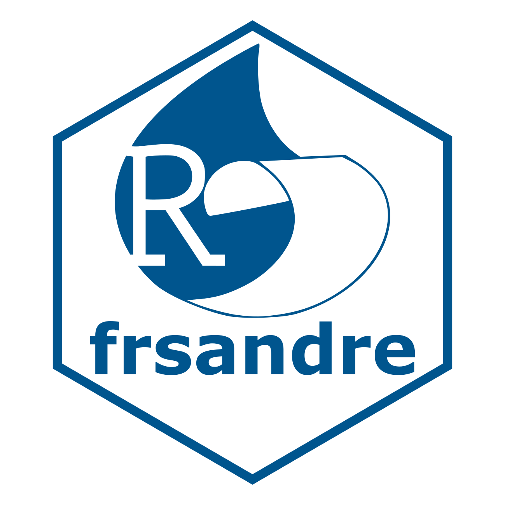

# frsandre 

<!-- badges: start -->

[](https://lifecycle.r-lib.org/articles/stages.html#experimental)
[](https://github.com/SocieteForestiere/frsandre/actions/workflows/R-CMD-check.yaml)

<!-- badges: end -->

The goal of **frsandre** is to facilitate access to data and referentials provided by the French National Service for Water Data and Referential Management (SANDRE). It provides tools to discover available resources and retrieve geographic data through SANDRE web services (WFS and WMS).

## Installation

You can install the development version of frsandre from [GitHub](https://github.com/) with:

``` r
install.packages("devtools")
devtools::install_github("SocieteForestiere/frsandre")
```

------------------------------------------------------------------------

## Quick execution

To discover the geographic resources available through SANDRE web services, try:

``` r
library(frsandre)

# List available WFS layers
wfs_layers <- get_layers("wfs")

# List available WMS layers
wms_layers <- get_layers("wms")
```

To retrieve spatial data from a SANDRE WFS service, use:

``` r
# Retrieve a geographic layer
data <- get_wfs(
  x = my_area,
  layer = "your_layer_name"
)
```

The `get_layers()` function lists the resources available through SANDRE WFS and WMS services, while `get_wfs()` retrieves spatial features intersecting a given geographic area.
